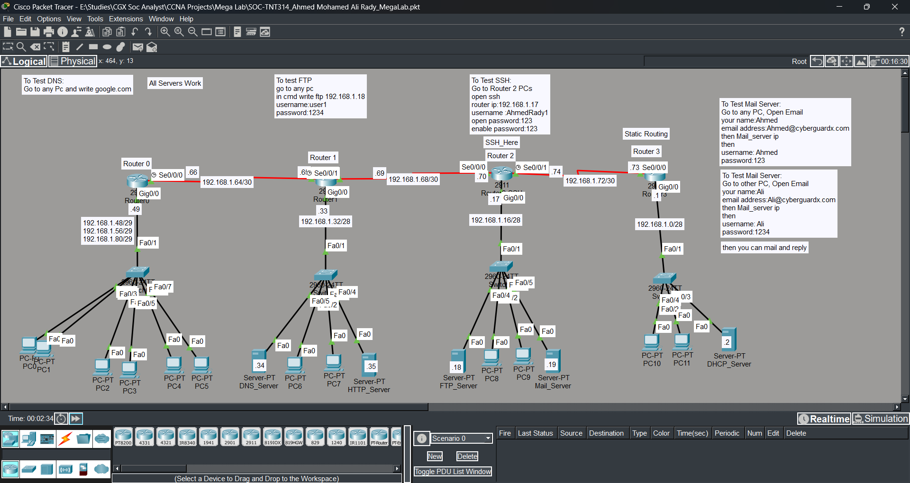

# Multi-Site Enterprise Network – Cisco Packet Tracer

A multi-site network lab built in Cisco Packet Tracer: 4 routers connected over serial WAN links with **static routing**, **VLSM** subnetting, and a set of core network services, tested end-to-end from client PCs.

## Topology

## Features
- 4 routers connected through /30 serial links
- Static routing between all sites
- VLSM addressing across LANs and WAN links
- Network services: DNS, HTTP, FTP, Mail (SMTP/POP3), DHCP
- Secure remote access to Router 2 via SSH

## Addressing plan

| Segment | Network | Notes |
|---|---|---|
| WAN R0–R1 | 192.168.1.64/30 | Serial |
| WAN R1–R2 | 192.168.1.68/30 | Serial |
| WAN R2–R3 | 192.168.1.72/30 | Serial |
| LAN R0 | 192.168.1.48/29, .56/29, .80/29 | PC0–PC5 (gateway .49) |
| LAN R1 | 192.168.1.32/28 | DNS (.34), HTTP (.35), PC6–PC7 |
| LAN R2 | 192.168.1.16/28 | FTP (.18), Mail (.19), PC8–PC9 |
| LAN R3 | 192.168.1.0/28 | DHCP (.2), PC10–PC11 |

## How to test
- **DNS:** from any PC, browse to a name served by the DNS server.
- **FTP:** from a PC command prompt run `ftp 192.168.1.18`.
- **SSH:** from a PC on Router 2's LAN, `ssh -l <user> 192.168.1.17`.
- **Mail:** configure the email client on two PCs with the mail server (domain: cyberguardx.com), then send and reply between users.
- **HTTP / DHCP:** open the web page and check PC IP assignment.

## Skills demonstrated
Static routing • VLSM • Cisco IOS CLI • DNS/DHCP/FTP/Mail services • SSH • Network troubleshooting

## Files
- `SOC-TNT314_..._MegaLab.pkt` – Packet Tracer file
- `topology.png` – network diagram

## Author
Ahmed Rady – SOC Analyst Intern | CCNA | Cisco Ethical Hacker
[LinkedIn](https://www.linkedin.com/in/ahmed-rady-b35252244) • [GitHub](https://github.com/AhmedRady01)
